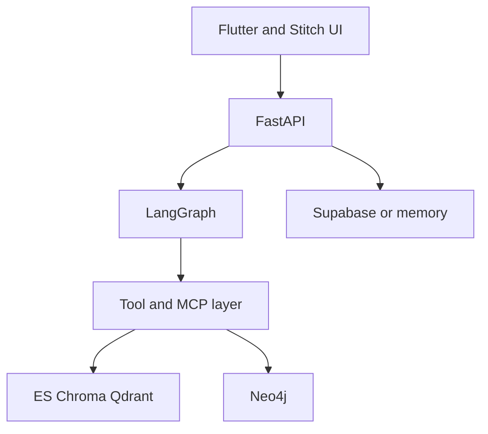

# TruthLens architecture

TruthLens is a multi-agent investigator, not a chat product. A FastAPI gateway starts a run, LangGraph walks six specialist agents, tools talk to hybrid retrieval and Neo4j, and the client renders a sealed dossier.

## Layers

| Layer | Package |
| --- | --- |
| Agent | `backend/app/agents` |
| Context | `InvestigationState` in `agents/graph.py` |
| Tool | `backend/app/tools` |
| Retrieval | `backend/app/retrieval` |
| Knowledge graph | `backend/app/graph` |
| MCP | `backend/app/mcp` |
| Evaluation | `backend/app/eval` |
| Observability | `backend/app/observability` |
| Safety | `backend/app/safety` |

## LangGraph path

Claim Extraction → FactCheck MCP → Evidence Retrieval (Chroma, Qdrant, Elasticsearch, web) → Neo4j → Credibility → Reasoning → Verdict.

Agents may cite only ledger IDs. The verdict schema drops any URL that was not retrieved.
